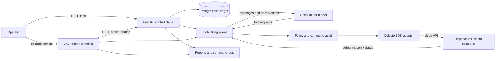

# SafeRepo

A bug-reproduction agent with Celesto Cloud execution, a trusted FastAPI/Postgres run ledger, and independently checked evidence.

**Status:** the API and ledger have been exercised locally; offline mocked tests pass on Windows and in the Linux runner. Live Celesto/LLM experiments have not yet run. Missing reports are intentional—not fabricated success results. The fixture repository URL and commit must be pinned before evaluation.

## Problem statement

Maintainers need a small regression test that demonstrates a reported bug without granting an agent access to their workstation, credentials, or other repositories. SafeRepo accepts an issue and pinned public repository, lets an agent inspect it in a disposable guest, and checks whether the generated test fails on buggy code and passes on a supplied fixed state.

The output is the generated test, real stdout/stderr and exit codes, a bimodal verdict, a run-ledger record, command decisions, and measured timing. This is a reproduction tool, not an implementation fixer.

## How I used Celesto

Celesto Cloud is the execution layer. The Linux Docker runner is the **trusted client**, not a substitute sandbox: repository cloning, package setup, reads/writes, and test execution are dispatched through the Celesto SDK to cloud computers. No agent command has a host subprocess fallback. Docker Compose runs `api` and `ledger` by default; the optional `tools` profile provides a one-off `runner` container.



The adapter is pinned to `celesto==0.1.4` and `celesto-core==2026.9.22`. `Computer` creation is deferred: `start()` performs the allocation. `resume()`, not `start()`, resumes a stopped computer. The public cloud constructor omits `network_policy` and `size_id`, so the adapter configures the verified generated request body before creation and refuses to continue if it cannot apply the policy.

Cloud assigns its own computer ID and does not accept our logical name. The `sbx-…` names in the ledger and audit log are **run identifiers**, not a claim that the cloud VM itself has that name. Evidence records the corresponding `cloud_id`; the orphan sweep deletes only IDs recorded by this project.

### Capability experiments (not yet claimed)

- **Persistence:** `scripts/run_capabilities.py` enables an external volume, writes a synthetic marker under `/home/ohm`, stops/resumes the guest, verifies the marker, then deletes the guest.
- **Network policy:** the same HTTPS request is tried in separate `open` and `off` guests. Curl must be present, the open control must succeed, the off request must fail, and both guests must be deleted. Cloud `open/off` is fixed at creation; **there is no verified per-domain cloud allow-list**.

Successful experiments add their real evidence paths to `reports/capabilities.json`. Failed experiments retain evidence but do not create a successful capability claim. Snapshots, CelestoFS, browser, and published ports are not claimed without a verified experiment.

## Setup

### Prerequisites

Docker Desktop with Linux containers, Docker Compose, a Celesto Cloud account/key, and an OpenRouter key plus a model supporting OpenAI-compatible tool calls. No paid upgrade is required by these scripts.

The Celesto native dependency has no Windows wheel for the checked version. Use the Linux runner; do not expect a full Windows `pip install -r requirements.txt` to work.

### Control plane (works without keys)

```powershell
docker compose up --build -d --wait
curl.exe http://localhost:8080/health
curl.exe http://localhost:8080/api/runs
```

Expected: `{"status":"ok"}` and a list containing `sbx-seeddemo1`. Valid upserts return 201; invalid name/state/target return 400. `/execute` returns 503 while credentials are missing. API access is bound to **127.0.0.1**, not the LAN. There is no application authentication; do not expose this API publicly.

### Credentials

Copy `.env.example` to a **local, gitignored** `.env`, then edit it privately:

```powershell
Copy-Item .env.example .env
```

Set `CELESTO_API_KEY`, `LLM_API_KEY`, and `LLM_MODEL`. Do not paste keys into issue text, source files, screenshots, command-line arguments, or guests. Placeholder values do not enable live runs. Leave `DATABASE_URL` at its Compose default; host-side direct DB connections require a different address.

`CELESTO_SIZE` labels the provisional cost estimate; optional `CELESTO_SIZE_ID` controls the actual named cloud size when supplied. Confirm the account's real size/rate before relying on the estimate. `SAFEREPO_NETWORK_MODE=open` is needed for clone/setup. `off` is used only by the isolated capability probe.

Recreate the API after changing environment configuration:

```powershell
docker compose up -d --force-recreate api
docker compose build runner
docker compose run --rm runner scripts/celesto_smoke_test.py
```

**Gate:** a real create → exec → delete smoke test must pass before attempting evaluation. Check cleanup errors and cloud inventory if a request loses its result. Never blindly retry a potentially billable allocation.

### Pin the fixture repository

Publish this repository under your own account, with no credentials or local SDK downloads included. Put the public URL and full immutable 40-character SHA into `fixtures/fixtures.json`. Publishing and pushing are operator actions; these scripts do not do them automatically.

```powershell
docker compose run --rm runner scripts/run_eval.py --dry-run
```

Dry-run prints the plan only; it is not an execution result or evidence.

### Run the experiments

Run sequentially to respect trial capacity:

```powershell
docker compose run --rm runner scripts/run_capabilities.py
docker compose run --rm runner scripts/run_containment.py
docker compose run --rm runner scripts/run_lifecycle.py
docker compose run --rm runner scripts/run_failure_policy.py
docker compose run --rm runner scripts/run_eval.py --reps 4 --runs 20
docker compose run --rm runner scripts/run_concurrency.py --jobs 5
```

The concurrency probe deliberately attempts five allocations once, captures rejections, and holds successful allocations until all attempts complete. It never purchases capacity or bypasses a limit. Exit 1 means an experiment had failures; inspect the evidence rather than deleting failed rows.

An interrupted eval retains completed attempts:

```powershell
docker compose run --rm runner scripts/run_eval.py --resume
```

Without `--resume`, existing eval evidence is not overwritten. Resume requires the same repo/SHA, and failed rows are never rerun merely to improve the score. Use different output paths for a separate experiment.

## Eval report

The planned evaluation is five authored Python bug fixtures × four fresh repetitions. Bugs cover price rounding, Unicode slug normalization, pagination indexing, empty CSV fields, and inclusive dates.

1. Clone the pinned repository into `/work/repo`.
2. The LLM writes a minimal test under the selected project's `tests/` directory.
3. Run the test on buggy code; require a nonzero status, the expected failure signature, and no recognized setup-failure marker.
4. Reject changes to tracked project files.
5. Create a fixed worktree, apply the committed `fixed/` overlay from that clean worktree, copy the same test, and require exit 0.

**No measured success rate, latency, or cost is available yet.** `reports/reliability.json` is generated only from actual attempts in `reports/evidence/runs.jsonl`, including failures. Per-run evidence keeps the test, verdict, output, cloud ID, and deletion outcome.

Summary arithmetic: sort by wall-clock time; even median is the mean of the central pair; p90 is the value at one-based rank `ceil(0.9*n)`; success rate is successes divided by all attempts; total cost is the sum of row estimates. For 20 runs, median uses ranks 10/11 and p90 uses rank 18.

Sandbox cost uses elapsed allocation time × a provisional size rate (`micro $0.015/hour`, `standard $0.030/hour`, `large $0.080/hour`). This is **not an invoice**, does not include LLM charges, and may undercount ongoing charges after failed cleanup. Do not represent the assumed label as a verified billed size. The postmortem must be written after the runs, not before.

## Containment test

The implemented test submits `rm -rf /work/saferepo-containment-target` through the sandbox adapter against **our own guest-only marker directory**. It requires a logged `block` decision, a surviving guest marker, unchanged SHA-256 of the trusted runner's Dockerfile, and successful deletion. The attacker command is never executed on the host.

`reports/containment.json` and its per-probe evidence are generated by the real test. This is a destructive-command policy test, not a claim that prompt-injection resistance has been exhaustively verified. Synthetic canaries may be placed in guests; real API keys stay only in the trusted control plane.

The regex policy and restricted write tool are defense in depth. Arbitrary repository code and shell commands remain untrusted: computed destinations, encoded programs, subprocesses, plugins, and malicious tests can bypass a regex policy. Open-network guests must contain **no long-lived secrets or host mounts**. Command audit decisions do not cover every syscall made by a test process.

## State and failure design

The ledger states are `created`, `ready`, `running`, `succeeded`, `failed`, `deleted`; every run uses `execution_target=celesto_sandbox`. Evidence and command logs live in trusted bind-mounted directories outside the guest.

The ten named stages are validation, allocation, readiness, clone/setup, inspection, agent/test generation, authoritative untrusted-test execution, classification/gold check, evidence persistence, and cleanup. The agent may also run exploratory tests in stage 6; stage 7 is not the first moment untrusted code could execute.

At stage 7, a controlled fault or unknown execution outcome selects **fresh** recovery: save the test in trusted memory/evidence, delete the old guest, create a different guest, restore the pinned repository and test, and retry once without another LLM call. Failed old-guest deletion aborts recovery. Nonzero pytest assertions are ordinary buggy-test results, not an infrastructure retry signal.

`run_failure_policy.py` records the controlled fault as such. `run_lifecycle.py` separately checks completion, raised failure, and a controlled `KeyboardInterrupt`; it does not prove cleanup after SIGKILL or power loss. Failed deletions remain failures and keep their handle available for a shutdown retry.

```powershell
docker compose run --rm runner scripts/sweep_orphans.py
# Review the IDs first. This next command authorizes their deletion:
docker compose run --rm runner scripts/sweep_orphans.py --yes
```

Only recorded SafeRepo cloud IDs are eligible. No known IDs is **not** proof that the entire cloud account is empty, especially after an allocation response was lost.

## Validation and demo

```powershell
# Offline tests: mocked guests, no submission metrics generated.
docker compose run --rm runner -m pytest tests/test_harness.py tests/test_runtime.py tests/test_probes.py -q
# Full submission checks: expected to fail until all real evidence exists.
docker compose run --rm runner scripts/validate_reports.py
docker compose run --rm runner -m pytest tests/test_reports.py -q
```

The demo still needs to be recorded at `demo/walkthrough.mp4`: show the real cloud guest doing work, a test verdict, the audit block, cleanup/recovery trace, and measured eval results. Do not show credentials. A scripted or mocked run is not a substitute for the required live demo.

## Limitations and attribution

- This build is not yet a completed submission: live smoke, capability/containment/failure experiments, 20 real runs, concurrency results, postmortem, and video remain pending.
- Fixtures are small, authored examples, not evidence of general reliability on arbitrary OSS repositories.
- Bimodal testing is a useful functional check, not a tamper-proof oracle against deliberately malicious test code running in the same guest.
- `fresh: true` describes a new allocation attempt; cloud startup failures have no successful boot measurement. Review per-run status rather than treating a zero as observed ready latency.
- The API is local-only and unauthenticated. The ledger is best-effort for operator scripts; recorded ledger errors are not silently discarded.
- SDK request-body integration is version-specific. Upgrade only after rechecking the live create/exec/delete gate.
- No snapshots, published-port viewer, universal egress enforcement, or hard-kill cleanup guarantees are claimed.
- Stack: Python, FastAPI, psycopg/Postgres, HTTPX/OpenRouter, Celesto SDK, pytest, and Docker Compose. Celesto is an external dependency; this project is not an official Celesto product.
- **AI coding assistance disclosure:** Claude Code was used to assist with planning, implementation, debugging, and tests. The operator must review the work and supply genuine run evidence. No generated metrics should be presented as measured results.
